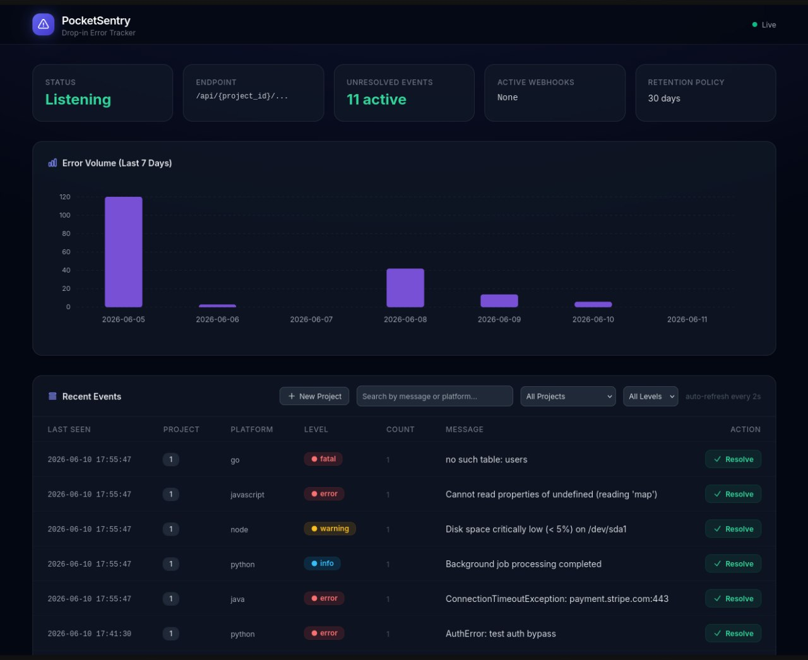

<div align="center">

# PocketSentry

**The 18 MB drop-in Sentry alternative for indie hackers.**

[](https://go.dev)
[](https://www.sqlite.org)
[](https://htmx.org)
[](LICENSE)
[](#quick-start)

<br>



<br>

*Your Sentry SDKs keep working. Your server bill doesn't.*

Read this in: [English](#english) | [Русский](README_RU.md)

</div>

<br>

<a id="english"></a>

## English

### The Problem

Self-hosting [Sentry](https://sentry.io) is an **infrastructure nightmare**:

| What you need | What it costs |
|---|---|
| 40+ Docker containers | Hours of DevOps work |
| Kafka, Redis, ClickHouse, PostgreSQL, Zookeeper... | 16 GB+ RAM minimum |
| `docker-compose.yml` from hell | Constant maintenance |

You just wanted to catch a `TypeError` in your side project. Not deploy a distributed system.

### The Solution

**PocketSentry** is a single, self-contained binary that speaks the Sentry protocol. Your existing SDKs (`sentry-python`, `@sentry/browser`, `sentry-go`, etc.) connect to it without any code changes — just swap the DSN.

| | Official Sentry (Self-hosted) | PocketSentry |
|---|---|---|
| **Deploy** | 40+ containers, Compose/K8s | **1 file, `./pocketsentry`** |
| **RAM** | 16 GB+ | **< 20 MB** |
| **Database** | PostgreSQL + ClickHouse + Redis | **SQLite (WAL mode + Deduplication)** |
| **Binary size** | Gigabytes of images | **~18 MB** |
| **Dependencies** | Kafka, Zookeeper, Snuba... | **Zero** |
| **Time to deploy** | 30+ minutes | **3 seconds** |
| **CGO** | N/A | **None — pure Go** |

### Features

- **Drop-in compatible** — works with official Sentry SDKs out of the box
- **Single binary** — templates embedded via `go:embed`, zero external files
- **Ultra-lightweight** — ~18 MB binary, < 20 MB RAM at runtime
- **Embedded SQLite** — pure-Go driver ([modernc.org/sqlite](https://modernc.org/sqlite)), no CGO hassle
- **Auto-deduplication** — identical errors are grouped by `(project, message, level)` with a hit counter
- **Real-time dashboard** — dark-themed UI with HTMX auto-refresh (every 2s)
- **Detailed Stacktraces** — Clickable rows to view full error details and raw JSON payloads
- **Analytics & Filters** — Interactive charts and instant HTMX filtering by error level
- **Basic Auth** — Built-in dashboard protection via username and password (ingestion API remains open)
- **Retention Policy** — Background auto-cleanup of old events from the database
- **Graceful shutdown** — SIGINT/SIGTERM → drain connections → close DB
- **CORS for ingestion** — browser SDKs work without proxy hacks (private dashboard routes get no CORS headers)
- **Gzip support** — transparent decompression of compressed payloads (with size limits)
- **Both endpoints** — `/api/{id}/store/` (legacy) and `/api/{id}/envelope/` (modern)
- **Health Check** — `/health` endpoint for uptime monitoring and orchestration
- **Webhooks** — Instant error alerts in Telegram and Discord (only for new unique errors)
- **Error Lifecycle** — Resolve errors directly from the dashboard (automatically reopens if the error reoccurs)
- **Project Management** — Create isolated workspaces for your different apps and fetch dynamic DSNs
- **Source Maps** — Automatic demangling of minified JavaScript stacktraces via local `.map` files
- **Performance Monitoring** — Track slow transactions with waterfall visualization of nested spans
- **Interactive Stacktraces** — Prism.js syntax highlighting and toggle to collapse/expand third-party library frames
- **Breadcrumbs Timeline** — Visual history of user actions (UI clicks, HTTP requests, console logs) preceding an error
- **Release Tracking** — Track errors associated with specific app versions (releases) with badges
- **Interactive Telegram Bot** — Resolve errors directly from the Telegram chat with action buttons
- **Notification Routing** — Project-specific webhook target overrides (Discord/Telegram) for smart alerting
- **Local Issue Notes** — Add team comments and debugging notes directly to errors in the dashboard
- **Smart Resolving** — Mark errors as "Resolved in Next Release" and let PocketSentry automatically detect regressions

### Quick Start

**1. Download and run:**

*Option A: Standalone Binary*
```bash
./pocketsentry --port 8080
```

*Option B: Docker*
```bash
docker-compose up -d
```

That's it. Open [http://localhost:8080](http://localhost:8080) to see the dashboard.

**2. Point your SDK:**

<details>
<summary><strong>Python</strong></summary>

```python
import sentry_sdk

sentry_sdk.init(
    dsn="http://public@localhost:8080/1",
    traces_sample_rate=0,
)

# Test it
raise ValueError("Hello from PocketSentry!")
```

</details>

<details>
<summary><strong>JavaScript / Node.js</strong></summary>

```javascript
const Sentry = require("@sentry/node");

Sentry.init({
  dsn: "http://public@localhost:8080/1",
});

// Test it
Sentry.captureException(new Error("Hello from PocketSentry!"));
```

</details>

<details>
<summary><strong>Browser (@sentry/browser)</strong></summary>

```javascript
import * as Sentry from "@sentry/browser";

Sentry.init({
  dsn: "http://public@localhost:8080/1",
});

// Test it
throw new Error("Hello from PocketSentry!");
```

</details>

<details>
<summary><strong>Go</strong></summary>

```go
import "github.com/getsentry/sentry-go"

func main() {
    sentry.Init(sentry.ClientOptions{
        Dsn: "http://public@localhost:8080/1",
    })
    defer sentry.Flush(2 * time.Second)

    sentry.CaptureMessage("Hello from PocketSentry!")
}
```

</details>

### CLI Options

| Flag | Default | Description |
|---|---|---|
| `--port` | `8080` | HTTP server port |
| `--db` | `pocketsentry.db` | Path to SQLite database file |
| `--admin-user` | `""` | Dashboard admin username (empty = auth disabled) |
| `--admin-pass` | `""` | Dashboard admin password |
| `--retention-days` | `30` | Auto-delete events older than N days (0 = disabled) |
| `--log-retention-days` | `30` | Auto-delete app logs older than N days (0 = disabled) |
| `--tx-retention-days` | `30` | Auto-delete transactions & spans older than N days (0 = disabled) |
| `--checkupd` | `false` | Check for a newer release on GitHub and update if confirmed |
| `--discord-webhook-url` | `""` | Discord Webhook URL for error notifications |
| `--tg-token` | `""` | Telegram Bot Token for error notifications |
| `--tg-chat-id` | `""` | Telegram Chat ID for error notifications |
| `--enable-ebpf` | `false` | Enable the eBPF agent for zero-config HTTP 500 tracing (requires root) |

Environment variables `PORT` and `DB_PATH` are also supported (flags take priority).
Admin credentials can also be set via `POCKETSENTRY_ADMIN_USER` / `POCKETSENTRY_ADMIN_PASS` (env wins over flags, so secrets do not show up in `ps` output).

> **Security note:** when `--admin-user`/`--admin-pass` (or the env variables) are not set, the dashboard is **not** protected. Always set credentials when exposing the server to a network.

The server handles **graceful shutdown**: press `Ctrl+C` and it will finish in-flight requests, close the database, and exit cleanly.

```
$ ./pocketsentry --port 9090 --db /data/errors.db

   ___           _        _   ___            _
  | _ \ ___  __ | | __ __| |_/ __| ___ _ __ | |_ _ _ _  _
  |  _// _ \/ _|| |/ // _| __\__ \/ _ \ '_ \|  _| '_| || |
  |_|  \___/\__||_\_\\__|\__|___/\___/_||_|\__|_| \_, |
                                                   |__/
  ──────────────────────────────────────────────────
  Version     : 3.2.0
  Dashboard   : http://localhost:9090
  Database    : /data/errors.db
  DSN         : http://public@localhost:9090/1
  Auth        : disabled
  Retention   : 30 days
  ──────────────────────────────────────────────────

  Point your Sentry SDK to the DSN above.
  Press Ctrl+C to stop.
```

### Source Maps Support

PocketSentry automatically demangles minified browser JavaScript back into readable source code with real file names and line numbers.

The approach is deliberately simple (no complicated API uploads):
1. Create a `sourcemaps` folder next to the binary (or mount it as a volume in Docker).
2. Drop your `.map` files there (e.g. `main.min.js.map`), or upload them via `POST /api/sourcemaps/upload` from CI.
3. When an error is opened, the server finds the map, restores the original code and highlights the line in the UI.

### Build from Source

```bash
git clone https://github.com/apvcode/pocketsentry.git
cd pocketsentry
go mod tidy
go build -o pocketsentry .
./pocketsentry
```

**Requirements:** Go 1.22+ (no CGO, no external C libraries).

### Roadmap

**General Roadmap:**

- [ ] **HTTP Latency Auto-Discovery via eBPF**: Measure transaction response times (p50/p90/p99) directly in the Linux kernel without SDKs or changes to application code.
- [ ] **SSL/TLS Decryption via eBPF**: Trace secure HTTPS connections by hooking SSL libraries (OpenSSL/Go TLS) at the kernel level.

<details>
<summary><strong>Completed Features</strong></summary>

- [x] **Real-time Log Tail (SSE)**: Stream logs to the UI in real-time with Live Tail mode.
- [x] **Log-based Alerting Rules**: Instant Telegram/Discord alerts when specific regex patterns appear in logs.
- [x] **Comprehensive Log & Transaction Retention**: Automated cleanup for logs, transactions, spans, attachments, and replays.
- [x] **OpenTelemetry OTLP Ingest**: Native endpoints (`/v1/traces`, `/v1/logs`) for direct OpenTelemetry SDK and Collector ingestion.
- [x] **Prometheus Metrics Endpoint**: Built-in `/metrics` exporter for infrastructure monitoring.
- [x] **Docker & Kubernetes eBPF Metadata**: Enrich connection topology with container names and pod namespace info using Docker/k8s APIs.
- [x] **Centralized Log Streaming**: Act as a lightweight log aggregator (like Loki) to query stdout/stderr application logs inside the UI.
- [x] **Session Replay**: Support and visualize user session recordings (sent by Sentry SDK via `rrweb`) to see exactly what the user did before the crash.
- [x] **Linux eBPF Agent**: Catch 500 Internal Server Errors and connection tracking directly from the Linux kernel without SDKs (run with `--enable-ebpf`).
- [x] **Network Topology Map**: Visual dashboard showing how your Docker containers/services interact.
- [x] **Smart Alerting Rules**: Conditional routing for webhooks (e.g., notify only if an error occurs > 10 times in 5 minutes).
- [x] **Source Maps API Upload**: Dedicated API endpoint to upload `.map` files directly from CI/CD pipelines.
- [x] **Latency Analytics**: Interactive dashboard graphs showing transaction percentile metrics (p50, p90, p99).
- [x] **Smart Grouping**: Custom regex-based rules to merge similar events (e.g. stripping dynamic IDs or hashes from messages).
- [x] **System & DB Metrics**: Dashboard charts for SQLite database size, error ingestion rates (RPS), and retention cleanup stats.
- [x] **Attachments Support**: Store and display screenshots, logs, and other files uploaded via the Sentry SDK.
- [x] Event detail page with full stacktrace
- [x] Retention policies (auto-delete old events)
- [x] Authentication
- [x] Project management (create/delete projects)
- [x] Source maps support
- [x] Docker image
- [x] Data Export (CSV)
- [x] Project-specific notification routing (different chats for different projects)
- [x] Interactive Telegram bot (resolving bugs directly from the chat)
- [x] Transactions support (Performance Monitoring)
- [x] Local Issue Notes (comments directly on errors)
- [x] Snooze Alert (Mute error notifications for a specific time)

</details>

### License

[MIT](LICENSE) — use it, fork it, ship it.
