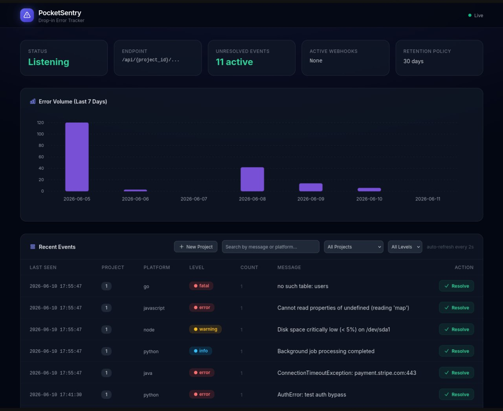

<div align="center">

# PocketSentry

**Альтернатива Sentry в одном файле размером 18 МБ для инди-разработчиков.**

[](https://go.dev)
[](https://www.sqlite.org)
[](https://htmx.org)
[](LICENSE)
[](#быстрый-старт)

<br>



<br>

*Ваши Sentry SDK продолжают работать. Ваш счёт за сервер — нет.*

Читать на: [English](README.md) | [Русский](#русский)

</div>

<br>

## Русский

### Проблема

Самостоятельный хостинг [Sentry](https://sentry.io) — это **инфраструктурный ад**:

| Что нужно | Чем платишь |
|---|---|
| 40+ Docker-контейнеров | Часы работы DevOps |
| Kafka, Redis, ClickHouse, PostgreSQL, Zookeeper... | 16+ ГБ RAM минимум |
| `docker-compose.yml` из преисподней | Постоянное обслуживание |

Ты просто хотел поймать `TypeError` в своём пет-проекте. А не деплоить распределённую систему.

### Решение

**PocketSentry** — это один автономный бинарник, который говорит на протоколе Sentry. Твои существующие SDK (`sentry-python`, `@sentry/browser`, `sentry-go` и др.) подключаются к нему без изменений в коде — просто замени DSN.

| | Sentry (Self-hosted) | PocketSentry |
|---|---|---|
| **Деплой** | 40+ контейнеров, Compose/K8s | **1 файл, `./pocketsentry`** |
| **RAM** | 16+ ГБ | **< 20 МБ** |
| **База данных** | PostgreSQL + ClickHouse + Redis | **SQLite (WAL-режим + дедупликация)** |
| **Размер** | Гигабайты образов | **~18 МБ** |
| **Зависимости** | Kafka, Zookeeper, Snuba... | **Ноль** |
| **Время деплоя** | 30+ минут | **3 секунды** |
| **CGO** | — | **Не нужен — чистый Go** |

### Возможности

- **Drop-in совместимость** — работает с официальными Sentry SDK из коробки
- **Один бинарник** — шаблоны встроены через `go:embed`, никаких внешних файлов
- **Ультралёгкий** — ~18 МБ бинарник, < 20 МБ RAM в рантайме
- **Встроенный SQLite** — pure-Go драйвер ([modernc.org/sqlite](https://modernc.org/sqlite)), без CGO
- **Авто-дедупликация** — одинаковые ошибки группируются по `(project, message, level)` со счётчиком
- **Дашборд реального времени** — тёмная тема, HTMX автообновление каждые 2 секунды
- **Детальные стек-трейсы** — кликабельные строки для просмотра детальной информации об ошибке и сырого JSON-пейлоада
- **Аналитика и фильтры** — интерактивные графики и мгновенная фильтрация ошибок по уровням (HTMX)
- **Basic Auth** — встроенная защита дашборда логином и паролем (API для приёма данных остаётся открытым)
- **Политика хранения** — фоновая авто-очистка старых событий из базы данных
- **Graceful Shutdown** — SIGINT/SIGTERM → дождаться запросов → закрыть БД
- **CORS для ingestion** — браузерные SDK работают без проксирования (приватные роуты дашборда CORS-заголовков не получают)
- **Gzip** — прозрачная декомпрессия сжатых payload'ов (с лимитом размера)
- **Оба эндпоинта** — `/api/{id}/store/` (legacy) и `/api/{id}/envelope/` (modern)
- **Health Check** — эндпоинт `/health` для мониторинга аптайма и оркестрации
- **Уведомления** — мгновенные алерты об ошибках в Telegram и Discord (только для новых уникальных ошибок)
- **Жизненный цикл ошибок** — возможность отмечать ошибки как «решённые» прямо из дашборда (автоматически переоткрываются, если баг повторится)
- **Управление проектами** — создание отдельных воркспейсов для разных приложений со своими DSN
- **Source Maps** — автоматическая расшифровка минифицированных JS-ошибок через локальные `.map` файлы
- **Мониторинг производительности** — отслеживание медленных транзакций с визуализацией дерева спанов (waterfall)
- **Интерактивные стек-трейсы** — подсветка синтаксиса (Prism.js) и скрытие системного кода (library frames) одной кнопкой
- **Лента хлебных крошек** — визуальный таймлайн действий пользователя (клики, запросы, консоль-лог) перед ошибкой
- **Отслеживание релизов** — отображение версии приложения для каждой ошибки с бейджами релизов
- **Интерактивный Telegram-бот** — решайте ошибки прямо из чата с помощью кнопок действий
- **Роутинг уведомлений** — указание индивидуальных Telegram/Discord вебхуков для каждого проекта
- **Локальные заметки** — оставляйте комментарии и заметки по дебагу прямо на странице ошибки
- **Умный авто-резолв** — отмечайте баг как «решённый в следующем релизе», и система сама откроет его при регрессии

### Быстрый старт

**1. Скачай и запусти:**

*Вариант А: обычный бинарник*
```bash
./pocketsentry --port 8080
```

*Вариант Б: Docker*
```bash
docker-compose up -d
```

Всё! Открой [http://localhost:8080](http://localhost:8080) и смотри дашборд.

**2. Подключи свой SDK:**

<details>
<summary><strong>Python</strong></summary>

```python
import sentry_sdk

sentry_sdk.init(
    dsn="http://public@localhost:8080/1",
    traces_sample_rate=0,
)

# Проверка
raise ValueError("Привет от PocketSentry!")
```

</details>

<details>
<summary><strong>JavaScript / Node.js</strong></summary>

```javascript
const Sentry = require("@sentry/node");

Sentry.init({
  dsn: "http://public@localhost:8080/1",
});

// Проверка
Sentry.captureException(new Error("Привет от PocketSentry!"));
```

</details>

<details>
<summary><strong>Браузер (@sentry/browser)</strong></summary>

```javascript
import * as Sentry from "@sentry/browser";

Sentry.init({
  dsn: "http://public@localhost:8080/1",
});

// Проверка
throw new Error("Привет от PocketSentry!");
```

</details>

<details>
<summary><strong>Go</strong></summary>

```go
import "github.com/getsentry/sentry-go"

func main() {
    sentry.Init(sentry.ClientOptions{
        Dsn: "http://public@localhost:8080/1",
    })
    defer sentry.Flush(2 * time.Second)

    sentry.CaptureMessage("Привет от PocketSentry!")
}
```

</details>

### Параметры CLI

| Флаг | По умолчанию | Описание |
|---|---|---|
| `--port` | `8080` | Порт HTTP-сервера |
| `--db` | `pocketsentry.db` | Путь к файлу базы данных SQLite |
| `--admin-user` | `""` | Логин для защиты дашборда (пусто = отключено) |
| `--admin-pass` | `""` | Пароль для дашборда |
| `--retention-days` | `30` | Количество дней хранения событий (0 = хранить вечно) |
| `--log-retention-days` | `30` | Количество дней хранения логов (0 = хранить вечно) |
| `--tx-retention-days` | `30` | Количество дней хранения транзакций и спанов (0 = хранить вечно) |
| `--checkupd` | `false` | Проверить наличие новой версии на GitHub и обновиться при подтверждении |
| `--discord-webhook-url` | `""` | URL вебхука Discord для уведомлений об ошибках |
| `--tg-token` | `""` | Токен Telegram-бота для уведомлений об ошибках |
| `--tg-chat-id` | `""` | ID чата Telegram для уведомлений об ошибках |
| `--enable-ebpf` | `false` | Включить eBPF-агент для перехвата HTTP 500 без SDK (нужен root) |

Также поддерживаются переменные окружения `PORT` и `DB_PATH` (флаги имеют приоритет).
Креды администратора можно задать через `POCKETSENTRY_ADMIN_USER` / `POCKETSENTRY_ADMIN_PASS` (env имеет приоритет над флагами — секреты не видны в `ps`).

> **Замечание о безопасности:** если `--admin-user`/`--admin-pass` (или env-переменные) не заданы, дашборд **не защищён**. Всегда задавайте креды, если сервер доступен из сети.

Сервер поддерживает **graceful shutdown**: нажми `Ctrl+C`, и он корректно завершит текущие запросы, закроет базу данных и выйдет.

```
$ ./pocketsentry --port 9090 --db /data/errors.db

   ___           _        _   ___            _
  | _ \ ___  __ | | __ __| |_/ __| ___ _ __ | |_ _ _ _  _
  |  _// _ \/ _|| |/ // _| __\__ \/ _ \ '_ \|  _| '_| || |
  |_|  \___/\__||_\_\\__|\__|___/\___/_||_|\__|_| \_, |
                                                   |__/
  ──────────────────────────────────────────────────
  Version     : 3.2.0
  Dashboard   : http://localhost:9090
  Database    : /data/errors.db
  DSN         : http://public@localhost:9090/1
  Auth        : disabled
  Retention   : 30 days
  ──────────────────────────────────────────────────

  Point your Sentry SDK to the DSN above.
  Press Ctrl+C to stop.
```

### Поддержка Source Maps

PocketSentry умеет автоматически расшифровывать минифицированный JavaScript-код из браузера, превращая его в читаемый исходный код с указанием реальных файлов и строк.

Подход максимально простой (без сложных загрузок через API):
1. Создайте папку `sourcemaps` рядом с бинарником (или примонтируйте её как Volume в Docker).
2. Положите туда ваши `.map` файлы (например, `main.min.js.map`) или загружайте их через `POST /api/sourcemaps/upload` из CI.
3. При открытии ошибки сервер автоматически найдёт карту, восстановит оригинальный код и подсветит нужную строчку в красивом блоке кода прямо в UI.

### Сборка из исходников

```bash
git clone https://github.com/apvcode/pocketsentry.git
cd pocketsentry
go mod tidy
go build -o pocketsentry .
./pocketsentry
```

**Требования:** Go 1.22+ (без CGO, без внешних C-библиотек).

### Дорожная карта

**Ближайшие планы:**

- [ ] **Автоматический замер задержек через eBPF**: измерение времени ответа (p50/p90/p99) транзакций на уровне сетевого стека ядра Linux без SDK.
- [ ] **Расшифровка SSL/TLS-трафика через eBPF**: перехват и трассировка защищённых HTTPS-соединений с помощью eBPF uretprobes на OpenSSL и Go TLS.

<details>
<summary><strong>Выполненные задачи</strong></summary>

- [x] **Живой стриминг логов (SSE)**: динамическое отображение логов на дашборде в режиме Live Tail в реальном времени.
- [x] **Алерты на основе логов**: мгновенная отправка алертов в Telegram/Discord при обнаружении регулярных выражений или критических событий в логах.
- [x] **Полная ротация и очистка логов/транзакций**: автоматическое удаление старых логов, транзакций, спанов, вложений и реплеев.
- [x] **Поддержка OpenTelemetry OTLP**: эндпоинты (`/v1/traces`, `/v1/logs`) для прямого приёма данных от OTel Collector и SDK.
- [x] **Prometheus-метрики**: встроенный эндпоинт `/metrics` для мониторинга состояния PocketSentry.
- [x] **eBPF-интеграция с Docker и K8s**: отображение реальных имён Docker-контейнеров и Kubernetes-подов на карте сети вместо сырых IP/PID.
- [x] **Сбор сырых логов (Log Aggregation)**: полноценный поиск по логам приложений (stdout/stderr) в реальном времени прямо на дашборде.
- [x] **Воспроизведение сессий (Session Replay)**: поддержка записей действий пользователей (через `rrweb` в Sentry SDK) с воспроизведением «видео» прямо в деталях ошибки.
- [x] **eBPF-агент (Linux)**: перехват 500-х HTTP-ошибок из ядра Linux без изменения кода приложения (запуск с флагом `--enable-ebpf`).
- [x] **Карта сети (Topology)**: визуальный дашборд взаимодействия ваших Docker-контейнеров с подсветкой узких мест.
- [x] **Умные правила уведомлений**: настройка условий отправки алертов (например, отправлять уведомление, только если ошибка произошла более 10 раз за 5 минут).
- [x] **Загрузка Source Maps через API**: API-эндпоинт для автоматической отправки `.map` файлов напрямую из CI/CD-пайплайнов.
- [x] **Аналитика задержек (Latency)**: графики перцентилей (p50, p90, p99) для отслеживания деградации скорости ответа транзакций на дашборде.
- [x] **Умное группирование**: пользовательские правила на основе регулярных выражений для объединения похожих ошибок.
- [x] **Здоровье системы и БД**: графики размера базы SQLite, объёма входящих запросов (RPS) и детальной статистики очистки устаревших данных.
- [x] **Поддержка вложений**: сохранение и отображение скриншотов, логов и файлов, отправленных клиентом через Sentry SDK.
- [x] Страница детального просмотра ошибки со стектрейсом
- [x] Политика хранения (авто-удаление старых событий)
- [x] Аутентификация
- [x] Управление проектами (создание/удаление)
- [x] Поддержка Source Maps
- [x] Docker-образ
- [x] Экспорт данных (CSV)
- [x] Умный роутинг уведомлений (разные чаты для разных проектов)
- [x] Интерактивный Telegram-бот (кнопки решения прямо из чата)
- [x] Поддержка транзакций (Performance Monitoring)
- [x] Локальные заметки (комментарии прямо на странице ошибки)
- [x] Заглушить на время (Snooze для подавления уведомлений)

</details>

### Лицензия

[MIT](LICENSE) — используй, форкай, шипь.
